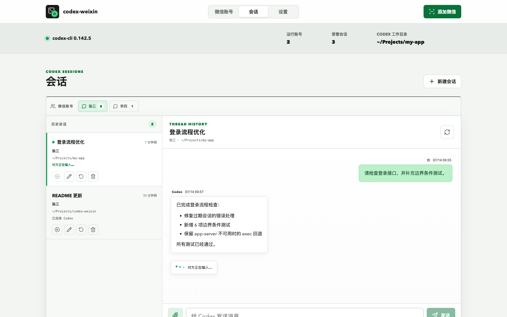
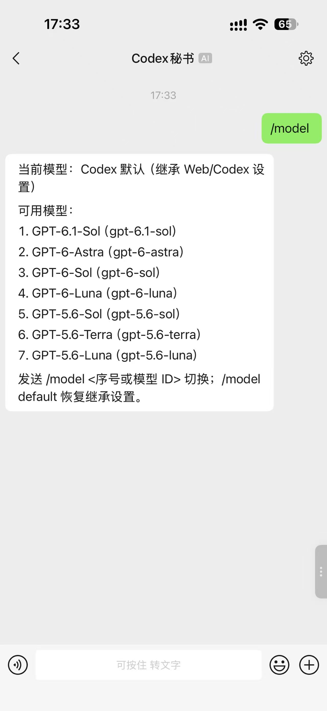
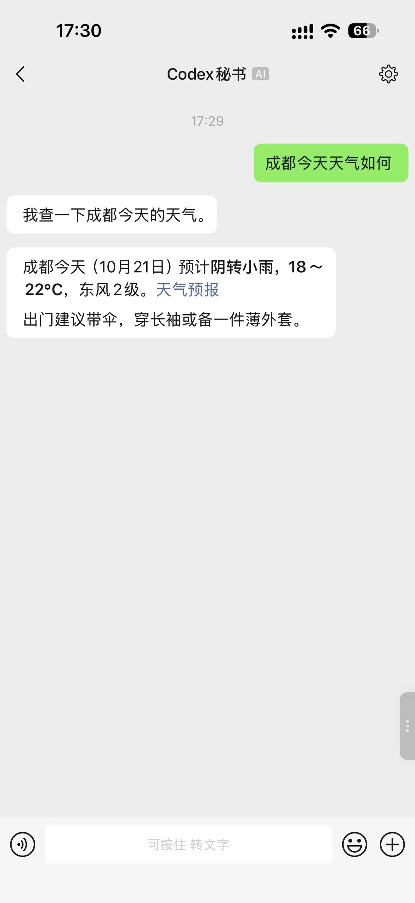
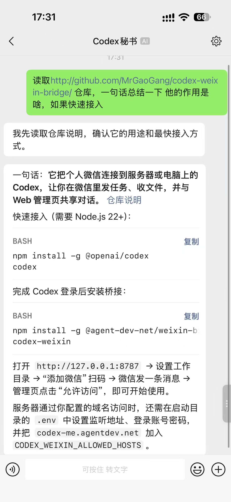
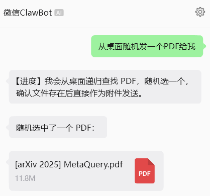
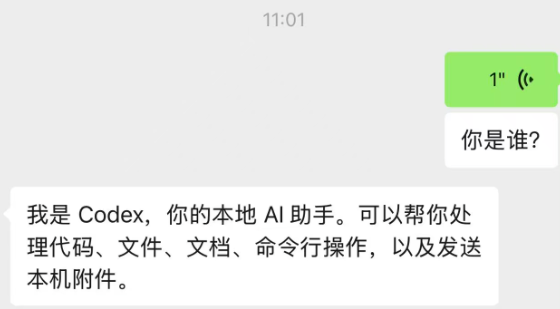

<h1 align="center">codex-weixin</h1>

> Forked from [XavierJiezou/codex-weixin](https://github.com/XavierJiezou/codex-weixin). Maintained at [MrGaoGang/codex-weixin-bridge](https://github.com/MrGaoGang/codex-weixin-bridge).

<!-- release:start -->
[](https://www.npmjs.com/package/@agent-dev-net/weixin-bridge)

**npm: @agent-dev-net/weixin-bridge@0.0.26**

```bash
npm install -g @agent-dev-net/weixin-bridge@0.0.26
codex-weixin
```
<!-- release:end -->

<p align="center">
  
</p>

<p align="center">
  <a href="./README.md">中文</a> | <strong>English</strong>
</p>

<p align="center">
  <strong>Connect multiple personal WeChat accounts to a local OpenAI Codex installation.</strong>
</p>

`codex-weixin` is a cross-platform WeChat service dedicated to Codex. Starting it opens a Web management page where users scan a WeChat QR code, manage accounts and workspaces, and switch Codex sessions.


[Interactive architecture and image export](docs/architecture.html) · [Diagram source](docs/architecture.architecture.json)

WeChat messages enter through iLink polling with persisted sync cursors, deduplication and retry backoff. AccountManager isolates each account; BridgeService authorizes senders, buffers messages and routes them into managed sessions. The HTTP server validates Host, login, Origin and mutation tokens before using those same sessions. HybridCodexRunner prefers a persistent local app-server and falls back to exec in auto mode. Both backends receive workspace, sandbox, approval, model and effort settings. Progress, replies and local-file actions return to WeChat or Web; private state stays on the service host. The HTTP update endpoint installs and verifies the active npm runtime, then restarts with the startup environment.

The default listener is local. Remote deployment requires an explicit bind address, allowed hosts and recommended login authentication.

## Feature status

The inherited baseline includes multiple accounts, QR login, Web/WeChat sessions, media input/output, app-server with exec fallback, model selection, process progress and update checks.

### Upstream VS this fork

The comparison uses upstream history retained in this repository through `769f4a1`; it does not describe future upstream versions.

| Capability | Upstream baseline | This fork |
| --- | --- | --- |
| Accounts, sessions, media, models and progress | Supported | Retained |
| Server deployment | Local access by default | **Added:** configurable listener and multiple allowed IPs/domains (`277a687`) |
| Web authentication | Local access without login | **Added:** environment credentials, HttpOnly session cookie and login dialog (`6fa8320`, `3366056`) |
| Execution permissions | Existing backend configuration | **Enhanced:** shared sandbox and approval settings across backends (`4cdb5fc`) |
| Web experience | Original management page | **Enhanced:** workspace layout, themes, responsive and account presentation (`f2a44b3`, `6bac437`) |
| Deployment and releases | Existing install/update flow | **Enhanced:** scoped npm publishing, cwd `.env`, startup environment retained on update |

## Web management preview

<p align="center">
  
</p>

## WeChat examples

Use WeChat to invoke local Codex skills, manage session models, or request tasks such as weather lookups and repository reading in natural language. These screenshots show example conversations in Chinese. Available skills, models and tools depend on Codex configuration on the service host; execution follows the configured workspace, sandbox and approval policy.

### Use a skill: photo styles and templates

Send an image and name an installed skill and template. For example: “Use template 1 of the amazing-images-template skill to turn this photo into a travel poster with a line-art extension.” The screenshot shows template selection, a sample result and a follow-up request for the original photo. Install the corresponding skill on the machine running Codex first.


### Use a command: inspect and switch models

Send `/model` to see the current and available models, then `/model <number or model ID>` to switch the current session. Send `/model default` to restore inheritance from Web/Codex settings. The model list in the screenshot is an example; your local configuration determines the available options.



### Look up the weather in natural language

Ask “What's the weather in Chengdu today?” Codex looks up the weather and returns conditions, temperatures and practical travel advice. The date and weather shown belong to that particular query.



### Read a repository: purpose and setup commands

Send a repository link with a request such as “Read this repository, summarize its purpose in one sentence, and explain how to get started.” Codex reads the repository documentation and returns a summary, installation commands and configuration steps. The commands in this screenshot are setup instructions.



### Media and voice input

Send images, videos or documents as task context, and receive local files returned by Codex.



Voice messages use WeChat transcription when available; otherwise the audio is passed to Codex as an attachment.



## Requirements

- Node.js `>=22`
- Git
- An installed and authenticated Codex CLI

```bash
npm install -g @openai/codex
codex --version
codex
```

## Install and start

Install globally from npm:

```bash
npm install -g @agent-dev-net/weixin-bridge
codex-weixin
```

Or install from source:

```bash
git clone https://github.com/MrGaoGang/codex-weixin-bridge.git
cd codex-weixin-bridge
npm install
npm run build
npm install -g .
codex-weixin
```

The service opens [http://127.0.0.1:8787](http://127.0.0.1:8787). To run without a global install:

```bash
npm start
```

`cwb` is a short alias for `codex-weixin`. Update the global package to the latest stable npm release and ensure the service is running with either command:

```bash
codex-weixin update
# or
cwb update
```

If the installed version is already current, a running service is left alone; a stopped service is started. You can also update manually with `npm install -g @agent-dev-net/weixin-bridge@latest`.

## Quick-start environment configuration

The service automatically reads `.env` in its **launch working directory** if present. Existing process environment variables win. It does not search the package or state directory. Copy [`.env.example`](.env.example), replace placeholders and keep credentials private. Web updates retain the startup environment and working directory; restart does not reopen the browser.

| Variable | Default / purpose | Example |
| --- | --- | --- |
| `CODEX_WEIXIN_HOST` | `127.0.0.1`; listener address | Local: `127.0.0.1`; server: `0.0.0.0` |
| `CODEX_WEIXIN_ALLOWED_HOSTS` | Additional allowed IPs/domains; loopback and the specific bind IP are allowed automatically | `203.0.113.10,codex.agentdev.net,192.168.1.10`; semicolons/whitespace also separate entries; URL/port entries such as `https://bridge.example.com` or `bridge.example.com:8787` are supported; bare domains allow the service port and standard HTTP 80/HTTPS 443 for reverse proxies; explicit ports/URLs match strictly (URLs default to HTTP 80/HTTPS 443) |
| `CODEX_WEIXIN_PORT` | `8787`; Web port | `8787`, or `0` for an OS-assigned port |
| `CODEX_WEIXIN_USERNAME` | Unset; must be paired with password | `admin` |
| `CODEX_WEIXIN_PASSWORD` | Unset; enables Web login when paired | `'replace-with-your-own-strong-password'` |
| `CODEX_WEIXIN_STATE_DIR` | `~/.codex-weixin-bridge`; private state; also the default Codex workspace | `/srv/codex-weixin/state` |
| `CODEX_WEIXIN_OPEN` | Automatically opens a browser unless `0` | `0` for headless servers |
| `CHAT_CODEX_BIN` | Optional executable candidate; Codex is otherwise discovered automatically | `/usr/local/bin/codex` |

Set both credentials or neither. Empty credentials, control characters, or a colon in the username prevent startup. Without credentials the service does not require login. Models, workspace paths, backend, sandbox and approval policy are Web settings persisted in `config.json`, not environment variables.

**Local best practice:** bind loopback and enable login. Save this as `.env` in the launch directory, replace the password, then run `codex-weixin`:

```dotenv
CODEX_WEIXIN_HOST=127.0.0.1
CODEX_WEIXIN_ALLOWED_HOSTS=127.0.0.1,localhost
CODEX_WEIXIN_PORT=8787
CODEX_WEIXIN_USERNAME=admin
CODEX_WEIXIN_PASSWORD='replace-with-your-own-strong-password'
CODEX_WEIXIN_OPEN=0
```

**Server best practice:** bind `0.0.0.0`, explicitly allow the addresses users actually visit, enable login and use a stable launch directory (also set WorkingDirectory in the service manager):

```dotenv
CODEX_WEIXIN_HOST=0.0.0.0
CODEX_WEIXIN_ALLOWED_HOSTS=203.0.113.10,codex.agentdev.net,192.168.1.10
CODEX_WEIXIN_PORT=8787
CODEX_WEIXIN_USERNAME=admin
CODEX_WEIXIN_PASSWORD='replace-with-your-own-strong-password'
CODEX_WEIXIN_STATE_DIR=/srv/codex-weixin/state
CODEX_WEIXIN_OPEN=0
```

Replace the documentation IP `203.0.113.10` and example domain with real addresses. `0.0.0.0` is a listener, not a browser destination or a substitute for the allowed-host list. For public access use an HTTPS reverse proxy preserving Host and Origin, and allow the service port only from trusted sources. Install and authenticate Codex on the server. Source installs use `npm start` after building; global installs use `codex-weixin`, launched from the directory containing `.env`. PowerShell environment variables such as `$env:CODEX_WEIXIN_OPEN="0"` override `.env` too.

## First connection

1. Open Settings and confirm the default and allowed Codex workspaces.
2. Select Add WeChat, scan the QR code, and confirm in WeChat.
3. Send any message to the connected account.
4. Return to WeChat Accounts and allow the pending sender.
5. Send the message again to start a Codex turn.

Repeat the QR flow to add more accounts. Every account has its own monitor, sender authorization, inbound directory, and managed-session state. A failed account does not stop the others. Scanning the same WeChat account again after an expired login refreshes the existing credentials while preserving its local remark, authorization, and sessions instead of creating an empty duplicate. Account removal can retain history: credentials are deleted immediately, while a later scan by the same WeChat user restores the previous remark, authorization, and managed sessions.

## Session management

The Sessions page manages conversations created and used by this server. It does not scan or take ownership of every Codex conversation created in other terminals.

Selecting a session reads its user messages and final replies from Codex's own persisted thread. The controls below the chat title select a model, reasoning effort, and process-progress behavior for the current session or keep inheriting global settings; they share the same session configuration used by the WeChat `/model`, `/effort`, and `/stream` commands. Process progress is enabled by default, appears in a collapsible Web timeline with elapsed time, and leaves the final answer as one stable response. The Web composer can submit text and multiple files as one turn and continues that same thread, so context remains shared with later WeChat messages. Uploads are isolated by account and session under `~/.codex-weixin-bridge/inbound/`, with at most 10 files and 100 MiB total per turn.

The UI uses local remarks instead of treating internal IDs as account names. Expand “Account IDs” on an account card to inspect its iLink Bot ID and User ID; Codex thread IDs remain hidden from the regular UI. Each account can have a local remark edited from the WeChat Accounts page; the remark is reused by session tabs, with `WeChat Account 1` used only as a fallback. The current QR and messaging APIs do not expose WeChat nicknames, avatars, or a profile lookup endpoint, so the page uses a default icon.

- Each authorized WeChat account has one active session and may own multiple named sessions.
- Activate chooses which Codex thread receives the sender's next message.
- Reset clears the recorded thread so the next message starts fresh context.
- Delete removes only the bridge record, not Codex's own history files.
- `/new` creates a new managed session for the current sender.
- `/resume` lists this sender's sessions with recent prompt summaries, timestamps, and distinct `R1`, `R2` selection codes; `/resume R1` switches back to the selected Codex thread without confusing the code with a title such as `Session 6`.

## WeChat commands

```text
/help                         Show commands
/status                       Show session, workspace, thread, backend, effective model, and reasoning effort
/bind <absolute-path>          Bind to an allowed workspace
/new                          Create a new managed Codex session
/resume                       List historical sessions with recent prompt summaries
/resume R<number>             Continue a session by its distinct R selection code
/model                        Show the current and available models
/model <number|model|default>  Switch this session's model or restore inheritance
/effort                       Show reasoning efforts supported by the current model
/effort <number|level|default> Switch this session's effort or restore inheritance
/stream                       Show this session's process-progress setting
/stream <on|off|default>       Enable, disable, or restore global process progress
/prompt start                 Buffer multiple WeChat messages
/prompt done                  Submit the buffer as one Codex turn
/stop                         Interrupt the current Codex task
```

Regular messages enter the active session. Images, files, videos, and voice/audio without transcription are saved under the account's inbound directory and added to the prompt by local path. WeChat voice transcription is preferred when available.

## Sending local files

Codex can request local-file delivery in its final response:

````text
```codex-weixin-actions
{
  "send": [
    { "type": "image", "path": "/absolute/path/chart.png" },
    { "type": "video", "path": "/absolute/path/demo.mp4" },
    { "type": "file", "path": "/absolute/path/report.pdf" }
  ]
}
```
````

Only absolute local paths are accepted. Native outbound types are `image`, `video`, and `file`; audio is sent as a regular file. Remote URLs are not uploaded as local files.

## Codex backend

The default `codexBackend` is `auto`. On the first Codex message, the service starts one persistent `codex app-server --stdio` process and uses the current `initialize`, `thread/*`, and `turn/*` protocol. New and resumed conversations prefer app-server; startup, handshake, or request failures automatically fall back to `codex exec` or `codex exec resume`.

WeChat does not currently expose Codex approval prompts, so app-server uses `approvalPolicy: "never"` and operates only within the configured Codex sandbox instead of waiting for an approval that cannot be answered in WeChat. The management page can still pin the backend to `app-server` or `exec` for diagnostics.

## Models and reasoning effort

The Settings page loads available models and model-specific reasoning efforts from Codex app-server. Leaving a field on "Use Codex settings" preserves the Codex configuration; choosing and saving an explicit value applies it to later Web and WeChat turns.

Send `/model` or `/effort` in WeChat to get a numbered list, then switch by number or exact ID. A WeChat-side selection applies only to the active managed session, without affecting other accounts, senders, or sessions. `/model default` and `/effort default` restore inheritance from Web/Codex settings. Continuing that session from the Web page uses the same session overrides.

The IkunCoding provider also exposes `gpt-5.6-sol`, `gpt-5.6-terra`, and `gpt-5.6-luna`. These options remain available after switching to another model in both the Web dropdown and WeChat `/model` list. Send `/status` in WeChat to inspect the effective model and reasoning effort.

## Starting, stopping and restarting

```bash
codex-weixin               # Start in the background; the terminal may close
codex-weixin stop          # Gracefully stop the service for the current state directory
codex-weixin restart       # Stop, then start with the current cwd, environment and .env
codex-weixin --foreground  # Foreground mode for debugging or service managers
```

Background logs are written to `<state>/logs/service.log`, normally `~/.codex-weixin-bridge/logs/service.log`. Ctrl+C gracefully closes a foreground service. Use foreground mode when systemd or Docker manages the process.

On the first upgrade, an older running process may not support the stop control channel. Stop it once with Ctrl+C in its original terminal, or `kill -TERM <PID>` after verifying its background PID, then launch the updated `codex-weixin`. Subsequent runs support `stop` and `restart`.

After editing `.env`, run `codex-weixin restart` from its directory to apply the new listener, port, allowed hosts and login settings. Exported environment variables still override `.env`. Both `stop` and `restart` locate the old service through the current `CODEX_WEIXIN_STATE_DIR`; keep that setting consistent, for example `CODEX_WEIXIN_STATE_DIR=/srv/codex-weixin/state codex-weixin restart`. To change the state directory itself, stop the old service using its old setting before starting with the new one.

Use **one `KEY=value` assignment per line in `.env`, without shell continuation backslashes**. Node treats a trailing backslash in an unquoted value as literal data; it can turn `0.0.0.0` into an invalid listener. The dotenv examples above show the correct format. Quote passwords containing spaces or `#`.

## Local data

Private service state is stored in this directory (override with `CODEX_WEIXIN_STATE_DIR`):

```text
~/.codex-weixin-bridge/
  accounts/                 One credential file per WeChat account
  retained-accounts.json    Recovery index for removed accounts; never stores tokens
  runtime/<account-id>/     Sender authorization and managed sessions
  inbound/<account-id>/     Inbound WeChat attachments
  config.json               Codex and workspace configuration
  logs/service.log          Background service log
```

The default Codex workspace is also `~/.codex-weixin-bridge/`. `CODEX_WEIXIN_STATE_DIR` changes state storage only; it does not change the Codex workspace. Configure the workspace independently in Web settings. Existing values in `config.json` remain effective.

`CODEX_WEIXIN_STATE_DIR` accepts absolute paths and expands a leading `~/` to the current user's home, including values read from `.env`. Other relative paths resolve against the current command directory: `.codex-weixin-bridge` means `<cwd>/.codex-weixin-bridge`, not the home directory. Prefer an absolute path or `~/.codex-weixin-bridge`; with a relative path, start, stop and restart from the same directory.

Older `~/.codex-weixin/` data is not moved automatically. Set `CODEX_WEIXIN_STATE_DIR` explicitly to that directory to keep using it, or stop the service and copy its complete contents to the new directory without overwriting existing data.

Do not commit or share this directory. The management API never returns WeChat tokens to the browser.

## Startup settings

See the quick-start environment configuration above for every variable and local/server examples.

## Security model

- Only explicitly allowed hosts are accepted; remote mutations require a matching HTTP Origin and the temporary request token.
- Every mutating API call requires an in-memory page token.
- WeChat credentials never reach the management page.
- Unknown senders are denied until explicitly allowed.
- `/bind` accepts only absolute paths under the workspace allowlist.
- `danger-full-access` bypasses the Codex filesystem sandbox and must be enabled only when full-machine access is acceptable.
- Concurrent accounts share local compute resources and Codex quotas.

## Automatic npm publishing

[`.github/workflows/publish.yml`](.github/workflows/publish.yml) publishes on code pushes to `main` and supports manual runs; README, Markdown, `docs/`, LICENSE and NOTICE-only changes are ignored. It type-checks and tests, increments the higher of the local and npm `latest` stable versions by one patch, packs the triggering commit, publishes `@agent-dev-net/weixin-bridge` publicly, then commits version metadata and both README release sections to the latest `main`. The CLI command remains `codex-weixin`.

Runs are serialized with up to 100 pending runs. Bot commits use `GITHUB_TOKEN` and do not retrigger this workflow. After public version metadata and tarball availability are verified, the workflow creates a version tag and GitHub Release with generated notes and the npm `.tgz` archive. Placeholder versions and processing states do not count as verified publication. A failed publish does not update Git metadata; if publishing succeeds but the metadata push fails, the workflow fails visibly and the next release uses npm's version to avoid collisions.

Setup:

1. Ensure your npm account can publish under the `@agent-dev-net` scope. Owning this GitHub repository does not grant npm scope access.
2. For the first publish, add an Actions secret named `NPM_TOKEN` containing a granular npm token with package/scope write access and permission for non-interactive direct publishing.
3. Prefer [npm Trusted Publishing](https://docs.npmjs.com/trusted-publishers/) after creating the package: configure GitHub Actions with owner `MrGaoGang`, repository `codex-weixin-bridge`, workflow filename `publish.yml`, publishing allowed, and no environment. Set the Actions variable `NPM_AUTH_MODE=oidc`, then remove `NPM_TOKEN`. The default mode is `token`; an early check rejects missing tokens and verifies authentication before building.
4. Allow Actions to write repository contents. The workflow declares `contents: write`; branch protections/rulesets must also permit metadata commits to `main`.

Use `npm pack --dry-run` to inspect the package without publishing. Actual publishing starts only after this workflow is committed and pushed to GitHub.

## Development

```bash
npm install
npm run dev
npm test
npm run typecheck
npm run build
```

The project is a clean-room independent implementation under the MIT License. Its iLink integration shape references `Tencent/openclaw-weixin`, along with public Codex/WeChat projects for app-server, media-transfer, and security-boundary practices. No AGPL source code was copied.

When started from a source checkout with `npm run dev` or `npm start`, the Web page checks for updates but does not install them; update the Git checkout and rebuild instead. Global installations and isolated `node_modules/@agent-dev-net/weixin-bridge` runtimes update the npm prefix that owns the active package and verify the target version and service entry before restarting. On Windows, the updater first releases any process working-directory lock inside the package tree so npm can replace it without `EBUSY`.

See [CHANGELOG.md](./CHANGELOG.md) for release history.
