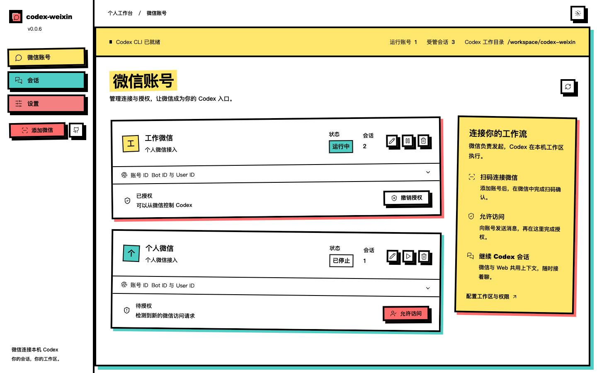
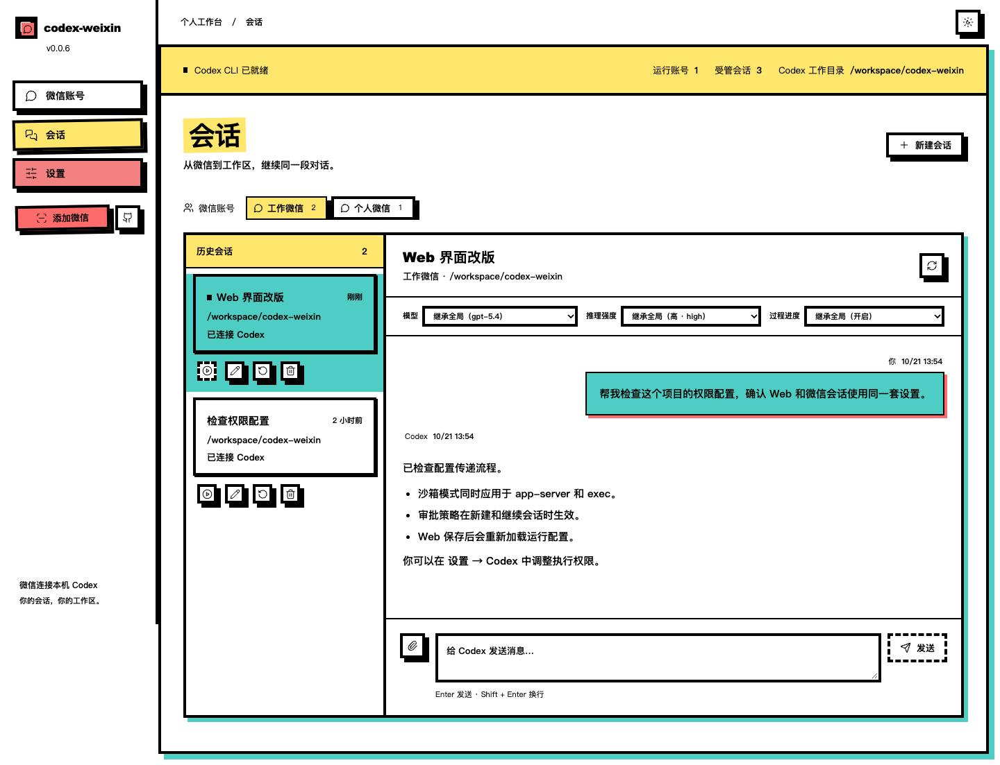
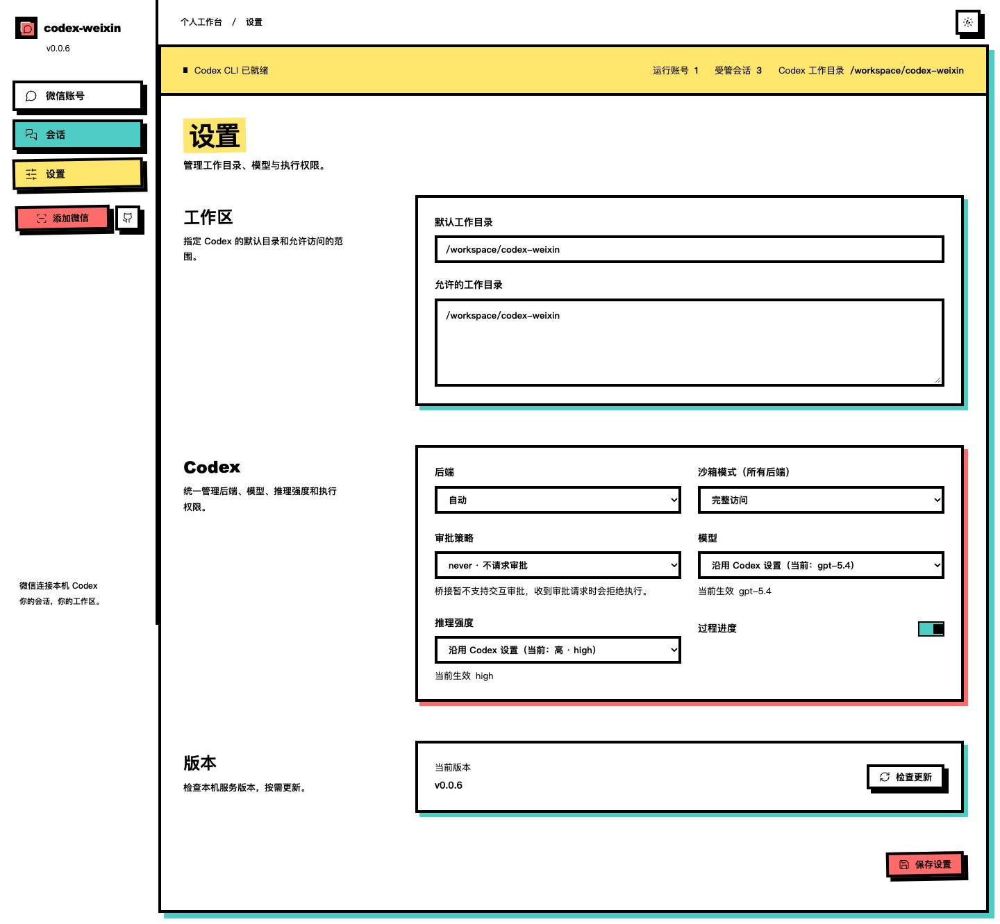

<h1 align="center">codex-weixin-bridge</h1>

> 声明: 本项目 Fork 自 [XavierJiezou/codex-weixin](https://github.com/XavierJiezou/codex-weixin)，并进行了 功能优化/新增，感谢上游作者及贡献者。当前维护仓库：[MrGaoGang/codex-weixin-bridge](https://github.com/MrGaoGang/codex-weixin-bridge)。

<p align="center">
  
</p>

<p align="center">
  <strong>中文</strong> | <a href="./README.en.md">English</a>
</p>

<p align="center"><strong>把个人微信接入本机 Codex，在微信和 Web 中继续同一段对话。</strong></p>

`codex-weixin` 是跨平台、本机运行的微信与 Codex 桥接服务。默认提供本机 Web 管理页，支持扫码接入、联系人授权、会话管理和运行配置；远程访问需显式配置监听地址、允许的 Host 和登录认证。


[查看可切换主题、导出图片的交互架构图](docs/architecture.html) · [架构图源文件](docs/architecture.architecture.json)

1. 微信消息通过 iLink 长轮询进入各账号的 monitor，持久化同步游标、去重并在失败时退避重试；媒体先保存到账号独立目录。
2. `AccountManager` 隔离账号状态，`BridgeService` 校验联系人授权、处理命令与消息缓冲，将消息路由到当前受管会话。Web API 经过 Host、登录、Origin 和修改令牌检查后使用同一套账号与会话逻辑。
3. `HybridCodexRunner` 在服务所在机器调用 Codex，`auto` 模式优先使用持久 app-server，通过 thread/turn 协议续聊，失败时回退 exec；工作区、沙箱、审批、模型和推理强度应用于执行。
4. 过程进度与最终回复返回 Web／微信；回复中的 actions 可触发本机文件上传回传。微信凭据、授权和会话索引保存在私有状态目录，Codex 自身维护 thread 历史。
5. 更新模块查询 npm／npmmirror；npm 安装方式可更新当前 runtime、验证版本，再携带启动环境与启动目录重启；源码运行仅检查更新。

## 支持的功能

| 功能 | 说明 |
| --- | --- |
| 多微信账号 | 并行接入多个个人微信账号，独立管理连接状态、备注、联系人授权和会话。 |
| 文本与多媒体 | 接收文本、图片、语音、视频和文档；单个微信附件最大 100 MiB。微信语音优先使用转写文本。 |
| 本机文件回传 | 将 Codex 生成的本机图片、视频和文件作为微信原生消息发回，音频按文件发送。 |
| 连续会话 | 新建、切换、重命名、重置和删除受管会话；微信与 Web 共用同一个 Codex thread。 |
| Web 聊天与附件 | 查看 Markdown 历史并继续对话；每次最多上传 10 个文件、合计 100 MiB。 |
| 模型与推理强度 | 全局配置及会话级覆盖，支持在 Web 或微信命令中切换。 |
| 过程进度与中断 | 默认反馈长任务的过程进度，Web 折叠展示处理过程，支持 `/stop` 中断任务。 |
| 工作区与权限控制 | 配置默认目录、允许目录、沙箱模式及审批策略，应用于 app-server、exec 和自动回退。 |
| 访问授权与登录 | 微信联系人需明确授权；可为 Web 配置用户名和密码，通过站内弹窗登录。 |
| Web 界面与更新 | 俏皮野兽派界面、响应式布局、手机会话切换；支持检查更新，npm runtime 可在页面中安装更新并重启。 |

### 上游 VS 本 仓库

对比基准为本仓库保留的上游历史（截至 `769f4a1`），不代表上游未来版本的能力。✅ 表示沿用，**新增／增强**表示本 Fork 的扩展；可通过本仓库提交历史核对。

| 能力 | 上游基线 | 本仓库 |
| --- | --- | --- |
| 多账号、扫码、微信／Web 会话、媒体收发 | ✅ 已支持 | ✅ 沿用 |
| app-server／exec 回退、模型、过程进度、检查更新 | ✅ 已支持 | ✅ 沿用并修复 |
| 服务器部署 | 本机访问为主 | **新增** 监听地址、多 IP／域名 Host 允许列表（`277a687`） |
| Web 登录鉴权 | 默认本机免登录 | **新增** 环境变量账号密码、HttpOnly Cookie、站内登录弹窗（`6fa8320`、`3366056`） |
| 执行权限配置 | 原有后端配置 | **增强** 两种后端统一应用沙箱与审批设置（`4cdb5fc`） |
| Web 页面 | 原有管理页面 | **增强** 工作区布局、主题、响应式与账号展示（`f2a44b3`、`6bac437`） |
| 发布与部署配置 | 原有安装／更新流程 | **增强** scoped npm 自动发布、当前目录 `.env`、更新保留启动环境 |

## 快速使用

### 准备环境

需要 Node.js **22 或更高版本**，并已安装、登录 Codex CLI。源码安装还需要 Git。

```bash
npm install -g @openai/codex
codex --version
codex
```

首次运行 `codex` 后，按终端提示完成登录，再启动桥接服务。

### 安装并启动

<!-- release:start -->
[](https://www.npmjs.com/package/@agent-dev-net/weixin-bridge)

**npm: @agent-dev-net/weixin-bridge@0.0.23**

```bash
npm install -g @agent-dev-net/weixin-bridge@0.0.23
codex-weixin
```
<!-- release:end -->

服务默认打开 [http://127.0.0.1:8787](http://127.0.0.1:8787)。已安装时可用 `npm install -g @agent-dev-net/weixin-bridge@latest` 更新。

### 环境变量：说明与案例

启动时自动读取**当前运行目录**中的 `.env`（没有就跳过），已经存在的进程环境变量优先；不会到安装包目录或状态目录中搜索。可复制仓库中的 [`.env.example`](.env.example) 到启动目录并修改。不要提交真实密码，建议限制 `.env` 文件读取权限。Web 检查更新后的安装与重启会沿用启动环境；更新重启不重新打开浏览器。

| 环境变量 | 默认值／作用 | 配置案例 |
| --- | --- | --- |
| `CODEX_WEIXIN_HOST` | `127.0.0.1`，服务监听地址 | 本地 `127.0.0.1`；服务器 `0.0.0.0` |
| `CODEX_WEIXIN_ALLOWED_HOSTS` | 额外允许访问的 IP／域名；本机 Host 与具体监听 IP 自动允许 | `203.0.113.10,codex.agentdev.net,192.168.1.10`；也支持分号／空白分隔，可填写 `https://bridge.example.com` 或 `bridge.example.com:8787`；不带端口的域名允许服务端口及标准 HTTP 80／HTTPS 443，适合反向代理；显式端口或 URL 则严格匹配对应端口（URL 默认 HTTP 80／HTTPS 443） |
| `CODEX_WEIXIN_PORT` | `8787`，Web 监听端口 | `8787`；`0` 可由系统分配临时端口 |
| `CODEX_WEIXIN_USERNAME` | 默认未设置，需与密码同时设置 | `admin` |
| `CODEX_WEIXIN_PASSWORD` | 默认未设置，配置后启用 Web 登录 | `'请替换为你自己的强密码'` |
| `CODEX_WEIXIN_STATE_DIR` | `~/.codex-weixin-bridge`，私有状态目录；默认与 Codex 工作目录相同 | `/srv/codex-weixin/state`（推荐绝对路径） |
| `CODEX_WEIXIN_OPEN` | 默认自动打开浏览器，设为 `0` 关闭 | 服务器／后台运行 `0` |
| `CHAT_CODEX_BIN` | 可选的 Codex 可执行文件候选路径；默认自动寻找 CLI | `/usr/local/bin/codex`（按实际安装位置填写） |

用户名不能含冒号，用户名和密码不能含控制字符；只配置其中一项或配置空值会拒绝启动。未配置两项则免登录。模型、默认工作目录、允许目录、后端、沙箱及审批策略在 Web“设置”保存到 `config.json`，不是环境变量。

**本地最佳实践**：保持 `127.0.0.1`，也建议开启登录认证。将下列内容保存为启动目录的 `.env`，替换密码后执行 `codex-weixin`：

```dotenv
CODEX_WEIXIN_HOST=127.0.0.1
CODEX_WEIXIN_ALLOWED_HOSTS=127.0.0.1,localhost
CODEX_WEIXIN_PORT=8787
CODEX_WEIXIN_USERNAME=admin
CODEX_WEIXIN_PASSWORD='请替换为你自己的强密码'
CODEX_WEIXIN_OPEN=0
```

**服务器最佳实践**：监听 `0.0.0.0`，填写浏览器实际访问的公网／内网 IP 和域名，设置用户名、强密码并关闭自动打开浏览器。使用固定的启动目录保存 `.env`，服务管理器也应明确设置 WorkingDirectory。

```dotenv
CODEX_WEIXIN_HOST=0.0.0.0
CODEX_WEIXIN_ALLOWED_HOSTS=203.0.113.10,codex.agentdev.net,192.168.1.10
CODEX_WEIXIN_PORT=8787
CODEX_WEIXIN_USERNAME=admin
CODEX_WEIXIN_PASSWORD='请替换为你自己的强密码'
CODEX_WEIXIN_STATE_DIR=/srv/codex-weixin/state
CODEX_WEIXIN_OPEN=0
```

`203.0.113.10` 是示例地址，请替换成真实服务器地址。`0.0.0.0` 是监听地址，不是浏览器访问地址，也不应作为远程允许列表的替代。公网建议通过 HTTPS 反向代理访问，防火墙仅向可信来源开放服务端口；反向代理应保留正确 Host 和 Origin。Codex CLI 的登录与工作目录都配置在服务器上。

### 启动、停止与重启

```bash
codex-weixin               # 默认后台启动，终端可关闭
codex-weixin stop          # 正常停止当前状态目录对应的服务
codex-weixin restart       # 先停止，再使用当前目录、环境与 .env 启动
codex-weixin --foreground  # 前台运行，适合调试或交给服务管理器
```

后台服务日志保存在 `<状态目录>/logs/service.log`，默认是 `~/.codex-weixin-bridge/logs/service.log`。前台运行时可用 Ctrl+C 正常退出；systemd／Docker 等需要以前台模式运行时使用 `--foreground`。

首次升级时，如果旧进程不支持停止控制通道，请先在原终端按 Ctrl+C 停止（后台进程则确认 PID 后使用 `kill -TERM <PID>`），再运行新版 `codex-weixin`。之后即可使用 `stop` 和 `restart`。

修改 `.env` 后，在该文件所在目录执行 `codex-weixin restart` 即可应用新的端口、监听地址、Host 允许列表和登录配置；当前终端已导出的同名变量仍优先。`stop` 和 `restart` 按当前 `CODEX_WEIXIN_STATE_DIR` 定位原服务，因此自定义状态目录时必须保持一致，例如 `CODEX_WEIXIN_STATE_DIR=/srv/codex-weixin/state codex-weixin restart`。如修改了状态目录，先使用旧目录配置停止旧服务，再用新目录配置启动。

`.env` 是配置文件，**每行一个 `KEY=value`，行尾不要添加 shell 命令续行用的反斜杠**。Node 会将未加引号值末尾的反斜杠作为值的一部分，例如监听地址会变成无效的 `0.0.0.0\`。上述 `.env` 代码块可以直接作为格式参考；含空格或 `#` 的密码应加引号。

### 连接微信并开始使用

1. 打开管理页，进入“设置”，确认默认工作目录和允许的目录；按需选择模型、沙箱及审批策略，保存设置。
2. 点击“添加微信”，使用微信扫码并确认登录。
3. 从微信向接入账号发送一条消息，让服务识别联系人。
4. 回到“微信账号”，对出现的访问请求点击“允许访问”。
5. 再次在微信发送任务，Codex 即会在工作目录中处理；也可进入 Web“会话”继续聊天。

例如，发送“查看当前项目结构，说明每个目录的作用”。发送 `/new` 开始新会话，发送 `/resume` 查看历史会话，发送 `/stop` 中断当前任务。

继续添加账号时重复扫码即可。已有账号重新扫码会刷新凭据并保留本机备注、授权和会话；移除账号时可选择保留历史，以便同一微信用户重新扫码后恢复。

<details>
<summary>从源码运行</summary>

```bash
git clone https://github.com/MrGaoGang/codex-weixin-bridge.git
cd codex-weixin-bridge
npm install
npm run build
npm start
```

开发时使用 `npm run dev`。如需全局命令，在构建后运行 `npm install -g .`。

</details>

## 页面截图与使用说明

以下 Web 截图展示俏皮野兽派界面，使用隔离的演示账号、路径和会话内容；实际运行时展示你的本机数据。

### 微信账号：连接状态与联系人授权

查看账号是否运行、包含多少会话，以及是否完成访问授权。支持修改备注、启停账号、允许或撤销联系人访问；展开“账号 ID”可查看 Bot ID 和 User ID。



### 会话：读取历史并继续聊天

按微信账号筛选受管会话，在同一 Codex thread 中继续聊天。标题下方可覆盖模型、推理强度和过程进度，底部支持文本及附件输入。手机端点击会话进入聊天，通过返回按钮回到列表。



### 设置：工作区、模型与执行权限

配置默认工作目录和允许目录，选择 Codex 后端、沙箱模式、审批策略、模型和推理强度，并控制过程进度。更改后点击“保存设置”；页面底部也提供版本检查入口。



### 登录：用户名与密码弹窗

仅在启动时配置了用户名和密码后显示。支持显示／隐藏密码、登录中状态和错误提示，使用服务端配置的凭据登录。


### 微信端案例

直接在微信中调用本机 Codex 的 Skill、管理会话模型，或用自然语言发起天气查询、仓库读取等任务。以下截图展示实际对话；可用 Skill、模型和工具取决于服务所在机器的 Codex 配置，任务执行受工作区、沙箱及审批策略约束。

#### 使用 Skill：照片风格与模板

发送图片并指定已安装的 Skill 和模板。例如：“使用 /amazing-images-template skill 模板 1，帮我把图片修改为实景延伸线稿旅行海报风格”。截图展示模板选择、效果示例与后续原图处理提示；使用前需在运行 Codex 的机器上安装相应 Skill。


#### 使用命令：查看与切换模型

发送 `/model` 查看当前模型和可用模型，再发送 `/model <序号或模型 ID>` 切换当前会话；`/model default` 恢复继承 Web／Codex 设置。截图中的模型列表仅为示例，以本机实际返回为准。


#### 天气查询：自然语言获取信息

发送“成都今天天气如何”，由 Codex 查询天气并返回天气状况、气温和出行建议。截图中的日期与天气为当次查询结果。


#### 仓库读取：了解项目与接入步骤

发送仓库链接并说明需求，例如：“读取这个仓库，一句话总结它的作用，以及如何快速接入”。Codex 读取仓库说明后，返回用途概述、安装命令与配置步骤；截图中的命令是接入说明。


#### 多媒体与语音输入

发送图片、视频或文档作为任务上下文，并接收 Codex 回传的本机文件。


语音消息有微信转写文本时直接用于任务；没有转写文本时将语音作为附件交给 Codex。


## 详细使用与配置

下面介绍会话语义、微信命令、文件回传、部署和开发方式。

### 会话管理

“会话”页面只管理由本服务创建和使用的 Codex 会话，不扫描或接管其他终端产生的全部 Codex 历史记录。

选择一个会话后，右侧会从 Codex 自身保存的 thread 中读取历史用户消息和最终回复。聊天标题下方可以为当前会话选择模型、推理强度和过程进度，或继续继承全局设置；这与微信 `/model`、`/effort`、`/stream` 共用同一份会话配置。过程进度默认开启，在 Web 中折叠展示并记录处理用时，最终答案仍作为一个完整回复显示。可以直接在页面底部继续聊天，并通过回形针按钮将文本提示词和多个文件作为同一个 turn 发送；Web 和微信共用同一个 thread，上下文会保持连续。上传文件按微信账号和会话隔离保存在 `~/.codex-weixin-bridge/inbound/`，每次最多 10 个、合计不超过 100 MiB。

页面默认使用账号备注，不把内部 ID 当作账号名称。展开账号卡片中的“账号 ID”可以查看 iLink Bot ID 和 User ID；Codex thread id 仍不在普通页面显示。可以在“微信账号”页面给账号设置只保存在本机的备注；备注会同步用于会话标签。未设置备注时才使用“微信账号 1”这类默认名称。当前扫码和消息接口没有提供微信昵称、头像或个人资料查询能力，页面使用账号名称的首字作为标识。

- 每个已授权微信账号有一个当前活动会话，也可以拥有多个命名会话。
- “切换”决定该联系人下一条微信消息继续哪个 Codex thread。
- “重置”清空本服务记录的 thread，下一条消息创建新上下文。
- “删除”只删除本服务中的会话记录，不删除 Codex 自身保存的历史文件。
- 微信中的 `/new` 会立即为当前联系人创建新的受管会话。
- 微信中的 `/resume` 会按最近更新时间列出当前联系人的历史会话、最近内容摘要和时间，并为每项生成 `R1`、`R2` 这类独立切换编号；发送 `/resume R1` 可切换并继续原来的 Codex thread，不会与“会话 6”这类名称混淆。

### 微信内命令

```text
/help                         查看命令
/status                       查看当前会话、工作目录、thread、backend、实际模型和推理强度
/bind <absolute-path>          绑定到允许列表内的工作目录
/new                          创建新的受管 Codex 会话
/resume                       查看历史会话、最近内容摘要和序号
/resume R<编号>               按 R 切换编号继续指定的历史会话
/model                        查看当前模型和可用模型
/model <序号|模型 ID|default>  切换当前会话模型，或恢复继承设置
/effort                       查看当前模型支持的推理强度
/effort <序号|强度|default>    切换当前会话推理强度，或恢复继承设置
/stream                       查看当前会话的过程进度设置
/stream <on|off|default>       开启、关闭过程进度，或恢复继承全局设置
/prompt start                 开始缓冲多条微信消息
/prompt done                  将缓冲内容作为一次 Codex turn 提交
/stop                         中断当前 Codex 任务
```

普通消息直接进入当前活动会话。图片、文件、视频和无转写语音会先保存到账号独立的入站目录，再以本地路径加入 prompt；有微信转写文本的语音优先使用转写文本。

### 文件回传

Codex 可以在最终回复中声明需要发送的本机文件：

````text
```codex-weixin-actions
{
  "send": [
    { "type": "image", "path": "/absolute/path/chart.png" },
    { "type": "video", "path": "/absolute/path/demo.mp4" },
    { "type": "file", "path": "/absolute/path/report.pdf" }
  ]
}
```
````

只接受本机绝对路径。原生出站类型为 `image`、`video` 和 `file`；音频按普通文件发送。远程 URL 不会被当作本机文件上传。

### Codex 后端

默认的 `codexBackend` 是 `auto`。第一次收到 Codex 消息时，服务会启动一个持久的 `codex app-server --stdio` 进程，并使用新版 `initialize`、`thread/*` 和 `turn/*` 协议。新会话和已有会话都优先通过 app-server 运行；如果 app-server 无法启动、握手或处理请求，会自动回退到 `codex exec` 或 `codex exec resume`。

Web「设置 → Codex」支持沙箱模式和审批策略，保存后应用于 app-server、exec 和自动回退，包括已有会话的后续消息。沙箱模式沿用 `codexExecSandbox` 配置字段（现已作用于所有后端），审批策略使用 `codexApprovalPolicy`。例如：

```json
{
  "codexExecSandbox": "danger-full-access",
  "codexApprovalPolicy": "never"
}
```

审批策略支持 `never`、`on-request`、`untrusted` 和旧版 `on-failure`。未配置时，app-server 保持 `never`，exec 沿用 Codex 自身设置。桥接目前没有交互审批入口，收到审批请求会拒绝执行。

### 模型和推理强度

“设置”页面会从 Codex app-server 读取可用模型和各模型支持的推理强度。选择“沿用 Codex 设置”时使用 Codex 自身配置；选择具体模型或推理强度并保存后，后续 Web 和微信消息都会使用该配置。

微信中发送 `/model` 或 `/effort` 可以查看带序号的选项，再用序号或英文 ID 切换。微信端设置只覆盖当前受管会话，不影响其他微信账号、联系人或会话；发送 `/model default`、`/effort default` 可恢复继承 Web/Codex 设置。Web 继续该会话时也会沿用这份会话设置。

IkunCoding 提供方会额外显示 `gpt-5.6-sol`、`gpt-5.6-terra` 和 `gpt-5.6-luna`。切换到其他模型后，这三项仍会保留在下拉列表和微信 `/model` 列表中。微信发送 `/status` 可以查看当前生效的模型和推理强度。

### 本地数据

服务状态保存在以下目录（可通过 `CODEX_WEIXIN_STATE_DIR` 修改）：

```text
~/.codex-weixin-bridge/
  accounts/                 微信账号凭据，每个账号一个文件
  retained-accounts.json    已移除账号的恢复索引，不包含 token
  runtime/<account-id>/     联系人授权和受管会话状态
  inbound/<account-id>/     微信入站附件
  config.json               Codex 和工作区配置
  logs/service.log          后台服务日志
```

默认 Codex 工作目录同样为 `~/.codex-weixin-bridge/`。`CODEX_WEIXIN_STATE_DIR` 只改变状态数据的存放位置，不会自动改变 Codex 工作目录；工作目录在 Web“设置”中单独配置，已有 `config.json` 中保存的值继续生效。

`CODEX_WEIXIN_STATE_DIR` 支持绝对路径和以 `~/` 开头的主目录路径（包括 `.env` 中的值）；例如 Ubuntu 用户可写 `~/.codex-weixin-bridge` 或 `/home/ubuntu/.codex-weixin-bridge`。其他相对路径按当前命令所在目录解析，例如 `CODEX_WEIXIN_STATE_DIR=.codex-weixin-bridge` 指的是 `<当前目录>/.codex-weixin-bridge`，并不是主目录中的同名目录。推荐使用绝对路径或 `~/.codex-weixin-bridge`；使用相对路径时，启动、停止与重启都必须从同一个目录执行。

旧版本的 `~/.codex-weixin/` 数据不会自动移动。如需继续使用旧数据，可显式设置 `CODEX_WEIXIN_STATE_DIR` 为旧目录；迁移时请先停止服务，再将旧目录完整复制到新目录，避免覆盖已有数据。

不要提交或分享该目录。管理 API 不会把微信 token 返回给浏览器。

### 启动设置

完整的变量说明、`.env` 示例与本地／服务器最佳实践见前文“环境变量：说明与案例”。源码部署在构建后，从含 `.env` 的固定目录执行 `npm start`；全局安装则从该目录执行 `codex-weixin`。Windows PowerShell 也可设置 `$env:CODEX_WEIXIN_OPEN="0"` 等环境变量，优先级高于 `.env`。

### 安全边界

- Web 服务默认只监听本机；远程访问需显式配置监听地址与允许的 Host，修改请求仍校验 Origin 和临时令牌。
- 所有修改 API 都需要页面运行时临时令牌。
- 微信凭据永远不返回管理页面。
- 未知联系人默认拒绝，必须在管理页明确允许。
- `/bind` 只能选择允许列表内的绝对工作目录。
- `danger-full-access` 会绕过 Codex 文件系统 sandbox；只有接受整机访问风险时才启用。
- 多账号可以并行触发 Codex，会共同占用本机 CPU、内存和 Codex 配额。

### 自动发布到 npm

工作流为 [`.github/workflows/publish.yml`](.github/workflows/publish.yml)。Push 到 `main` 时（忽略仅修改 README、Markdown、`docs/` 等文档的提交；也支持手动运行）会检查类型、运行测试，取本地与 npm `latest` 较高版本并递增 patch，例如 `0.0.1 → 0.0.2`，构建后公开发布 `@agent-dev-net/weixin-bridge`，然后自动更新两份 README、`package.json` 和 lockfile。CLI 命令仍为 `codex-weixin`。

发布按队列串行执行，最多等待 100 次运行；每次打包触发该运行的提交，元数据回写以最新 `main` 为基础，保留期间的新提交。自动提交使用 `GITHUB_TOKEN`，不会再次触发 Push 工作流，确认 npm 版本元数据和安装包均可公开访问后，会创建对应版本 Tag、GitHub Release（自动生成说明）并附上 npm `.tgz` 安装包。发布占位版本或处理中状态不会视为验证成功。发布失败时不会回写版本；若 npm 已成功而 Git 回写失败，该次运行会明确报错，下次发布会参考 npm 版本避免重复版本号。

首次启用：

1. 确认你的 npm 账号有 `@agent-dev-net` scope 的发布权限。GitHub 仓库名或账号名不会自动授予该权限；没有权限需先取得授权或修改包名及 README 发布区块。
2. 首次发布可在 GitHub 仓库 **Settings → Secrets and variables → Actions** 新增 `NPM_TOKEN`，使用拥有该 scope/package 写权限、允许非交互直接发布的 npm granular token。不要把 token 写入代码。
3. 推荐包创建后启用 [npm Trusted Publishing](https://docs.npmjs.com/trusted-publishers/)：在 npm 包设置添加 GitHub Actions publisher，Owner 为 `MrGaoGang`，Repository 为 `codex-weixin-bridge`，Workflow filename 为 `publish.yml`，允许发布；不设置 Environment。配置后在 Actions Variables 中设置 `NPM_AUTH_MODE=oidc`，然后删除 `NPM_TOKEN` secret。默认模式为 `token`，运行开始时会检查 token 是否存在并验证认证；缺失时直接报错，不会进入打包发布。
4. 仓库需允许 Actions 读写内容（工作流已声明 `contents: write`）。若 `main` 有保护规则或 Ruleset，需要允许此自动化回写版本文件，否则 npm 发布成功后 Git 回写会失败。

本地验证发布内容可运行 `npm pack --dry-run`，不会发布到 npm。只有提交并 Push 本工作流到 GitHub 后才会触发实际发布。

### 开发

```bash
npm install
npm run dev
npm test
npm run typecheck
npm run build
```

开发入口同样只启动本机 Web 服务。浏览器页面、JSON API、多账号运行时、扫码状态机和受管会话都有自动化测试。

源码目录通过 `npm run dev` 或 `npm start` 启动时，Web 只检查新版本，不会自动安装；请通过 Git 更新源码后重新构建。全局安装和独立 `node_modules/@agent-dev-net/weixin-bridge` runtime 会更新当前实际运行的 npm prefix，并在重启前验证目标版本和服务入口。Windows 更新前会自动释放服务进程对包目录的工作目录占用，避免 npm 因 `EBUSY` 无法替换文件。

### 参考与许可

本项目 Fork 自 [XavierJiezou/codex-weixin](https://github.com/XavierJiezou/codex-weixin)，感谢上游作者和贡献者。当前仓库在上游基础上持续调整 Web 体验、运行配置和发布流程。微信 iLink 接入相关参考与声明见 [NOTICE](./NOTICE)，许可见 [MIT License](./LICENSE)。

版本变更见 [CHANGELOG.md](./CHANGELOG.md)。

### 社区

感谢 [LINUX DO](https://linux.do/t/topic/2599273) 社区佬友的支持与反馈。
